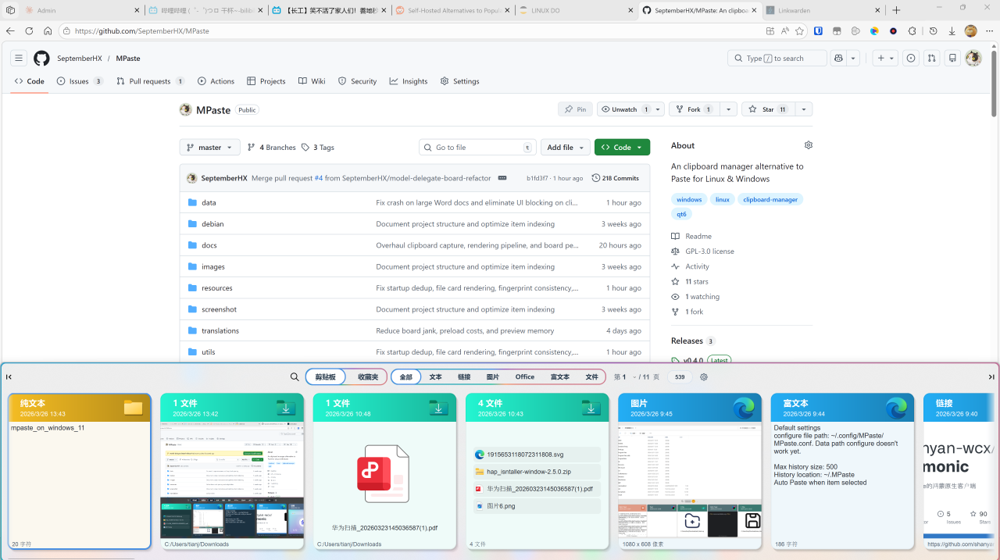
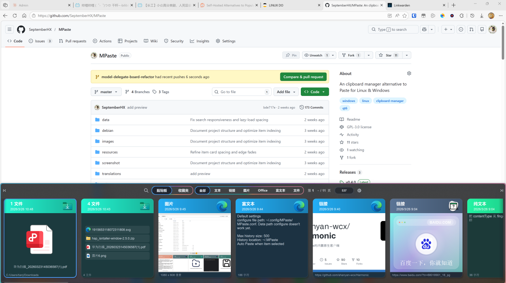

# MPaste

A modern clipboard manager for Windows and Linux, inspired by [Paste](https://pasteapp.io/) for macOS.

> MPaste has no affiliation with Paste for Mac. It is a Qt implementation inspired by that workflow and visual style.

Light mode:



Dark mode:



## Features

- Clipboard history for text, links, rich text, images, files, colors, and Office clipboard payloads.
- Card-based browsing with thumbnails, app icons, favicons, and metadata.
- Separate clipboard and favorites boards, with independent pinning and favoriting.
- Keyword search and content-type filters.
- Paged and continuous history browsing modes.
- Quick paste shortcuts: `Alt+[1-9, 0]` to paste by visible position.
- Plain-text paste shortcuts: `Ctrl+Enter` for the current selection, or `Alt+Shift+[1-9, 0]` for quick slots.
- Large preview dialog on `Space`, with zoom support for image previews.
- Detailed inspector dialog for viewing normalized content and raw MIME data.
- Alias rename, pin-to-top, multi-select, batch favorite/unfavorite, and batch delete actions.
- Export selected items to image, HTML, or text files when supported.
- Link preview fetching with OpenGraph metadata, preview images, and favicons.
- Persistent history stored in `.mpaste` files with embedded preview thumbnails.
- Current on-disk format is `.mpaste v6`; older v4/v5 files are still readable.
- Configurable history retention, max history size, item scale, theme mode, sound, and paste shortcut mode.
- Configurable global hotkey and optional auto-paste on selection.
- Optional external sync folder watching with incremental reloads.

## Keyboard Shortcuts

| Shortcut | Action |
|---|---|
| `Alt+[1-9, 0]` | Quick select and paste |
| `Alt+Shift+[1-9, 0]` | Quick select and paste as plain text |
| `Ctrl+Enter` | Paste current selection as plain text |
| `Space` | Open or close preview |
| `Left` / `Right` | Move selection |
| `Home` / `End` | Jump to start or end |
| `Tab` | Switch boards |
| Any printable character | Start search |

Hold `Alt` to show shortcut hints on visible cards.

## Platform Notes

### Windows

- Default global hotkey is `Alt+Q`, but it is configurable in settings.
- Alt-based hotkeys have extra handling to avoid ribbon keytip conflicts in Office and WPS.
- Paste injection supports multiple modes, including `Ctrl+V`, `Shift+Insert`, `Ctrl+Shift+V`, and `Alt+Insert`.
- Explorer integration can reveal copied files from the item context menu.

### Linux

- Linux supports X11 and GNOME 51 Wayland (Ubuntu 26.10) with the bundled companion extension.
- X11 build/runtime integration depends on X11, `xcb-keysyms`, and `xdo` / `xdotool`; GNOME Wayland integration uses Qt DBus.
- On GNOME Wayland, install the companion after building: `python3 tools/install_gnome_wayland.py --autostart`, then log out and log back in. See [Wayland setup](extensions/README.md). Source-app icons are resolved through GNOME (unknown apps use a fallback); other Wayland desktops are not supported by this bridge.
- On GNOME, [Focus My Window](https://extensions.gnome.org/extension/1005/focus-my-window/) can improve focus restoration after the global hotkey.
- Deepin V20 users can use the packaged `.deb` from the releases page.

## Configuration

MPaste uses `QSettings` for application preferences.

- Linux typically stores settings in `~/.config/MPaste/MPaste.conf`.
- Windows typically stores settings under `HKEY_CURRENT_USER\Software\MPaste\MPaste`.
- Clipboard history is stored separately under the configured save folder, which defaults to `~/.MPaste`.

Default settings:

| Setting | Default |
|---|---|
| Max history size | `500` |
| Retention policy | `30 days` |
| History save folder | `~/.MPaste` |
| Auto paste | `On` |
| Paste shortcut mode | `Auto` |
| Theme | `Dark` |
| History view mode | `Paged` |
| Item scale | `100%` |
| Copy sound | `On` |
| Global hotkey | `Alt+Q` |

## Build from Source

### Requirements

- C++17 compiler
- CMake 3.16+
- Qt 6 with `Widgets`, `Multimedia`, `Network`, `Xml`, and `LinguistTools`

Linux builds also require:

- `pkg-config`
- X11 development headers/libraries
- `xcb-keysyms`
- `xdo` / `libxdo`
- Qt 6 DBus development files

Package names vary by distro. Install the Qt 6 development packages plus the libraries above before configuring the project.

### Linux

```sh
git clone https://github.com/SeptemberHX/MPaste
cd MPaste
cmake -B build
cmake --build build -j8
```

### Ubuntu 26.10 / GNOME Wayland

System build dependencies (if not already installed):

```sh
sudo apt install build-essential cmake pkg-config qt6-base-dev qt6-multimedia-dev qt6-tools-dev qt6-tools-dev-tools qt6-wayland libx11-dev libxcb-keysyms1-dev libxdo-dev
cmake -S . -B build
cmake --build build -j4
python3 tools/install_gnome_wayland.py --autostart
```

Log out and back in once to load the new extension. Alt+Q opens the panel;
selecting an item restores the original window and pastes it. `--show` opens the
panel on first launch. `MPASTE_LOG_DIR` optionally redirects application logs.
To run the isolated desktop regression, use `python3 tests/gnome-wayland/run.py`.

### Windows

```sh
cmake -B build -DMPASTE_QT_ROOT=C:/Qt/6.8.0/mingw_64
cmake --build build
```

Optional CMake flags:

| Flag | Description |
|---|---|
| `-DMPASTE_QT_ROOT=<path>` | Qt installation prefix |
| `-DMPASTE_MINGW_BIN_DIR=<path>` | MinGW runtime directory used for Windows deployment |
| `-DMPASTE_ENABLE_WINDOWS_DEPLOY=OFF` | Disable post-build Windows deployment packaging |

### Rendering Backend

You can control the OpenGL backend with the `MPASTE_OPENGL_BACKEND` environment variable:

| Value | Behavior |
|---|---|
| `auto` | System default |
| `gles` | Force OpenGL ES |
| `software` | Force software rendering |
| `software-gles` | Force OpenGL ES with software fallback attributes |

## Credits

- [KDSingleApplication](https://github.com/KDAB/KDSingleApplication)
- Sound effects from [Zapsplat](https://www.zapsplat.com/)
- Icons by [Pixel Perfect](https://www.flaticon.com/authors/pixel-perfect) from [Flaticon](https://www.flaticon.com/)

## License

[GPLv3](LICENSE)

On GNOME Wayland, hotkeys also work for the XWayland preview: if the companion is not loaded, MPaste registers a GNOME custom shortcut that invokes `--toggle`. The companion takes over when available. This fallback only opens/closes MPaste; background clipboard capture and native automatic paste still require the companion. Shortcut changes are applied after editing finishes, and failed registrations restore the previous setting.

Context menus use consistent logical row/font sizing on GNOME and theme-aware action icons.

### Native menu backdrop blur

On GNOME 51 Wayland, the main panel, menus and dialogs use `ext-background-effect-v1` for real background blur with a translucent tint. This works directly through the compositor and does not need a new Shell extension session. Building this optional backend requires Qt 6.11+, `qt6-base-private-dev`, `libwayland-dev`, `libwayland-bin` and `wayland-protocols` containing the staging background-effect XML. Without these build dependencies or compositor support, menus use a translucent tint fallback.

Card hover tools blur the underlying card content locally because they share its Qt surface. The desktop backend applies blur only behind independent windows; it never blurs foreground text or controls.
